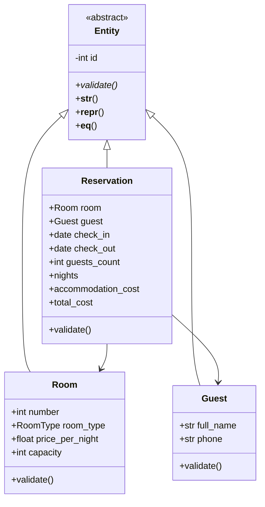

# Отчёт по лабораторной работе №2

**Тема:** Модули и пакеты Python. ООП  
**Вариант:** 18 — Управление отелем  
**Уровень:** Well-done (с выполнением требований Rare и Medium)

## 1. Цель работы
Реализовать MVP-приложение на Python с модульной структурой, объектно-ориентированным подходом, тестированием и сохранением результатов в SQLite. Запуск приложения организован в Docker.

## 2. Постановка задачи
Разработать консольную систему управления отелем. Предметная область включает номер, гостя и резервирование. Программа должна рассчитывать стоимость проживания, стоимость брони и проверять вместимость номера.

## 3. Принятые расчётные условия
- Ночь считается разницей между датой выезда и датой заезда.
- Стоимость проживания равна числу ночей, умноженному на цену за ночь.
- Сбор за бронирование принят равным 500 руб. (учебное допущение).
- Итоговая стоимость равна стоимости проживания плюс сбор.
- Нельзя создать бронь, если число гостей превышает вместимость номера.
- Нельзя создать две подтверждённые брони одного номера с пересекающимися датами.

## 4. Структура проекта
```text
hotel_management_system/
├── hotel/
│   ├── __init__.py
│   ├── models.py
│   ├── database.py
│   └── services.py
├── tests/
│   ├── test_models.py
│   └── test_database.py
├── data/
├── main.py
├── requirements.txt
├── Dockerfile
├── compose.yaml
├── pytest.ini
└── README.md
```

## 5. Описание ООП
Абстрактный класс `Entity` определяет общий идентификатор, managed-свойство `id` и абстрактный метод `validate`. Классы `Room`, `Guest` и `Reservation` наследуются от `Entity`.

Managed-атрибуты реализованы через `@property` и setter: у номера — `number`, `price_per_night`, `capacity`; у гостя — `full_name`, `phone`; у бронирования — `guests_count`. Сеттеры проверяют корректность значений.

Dunder-методы:
- `Entity`: `__str__`, `__repr__`, `__eq__`;
- `Room`: `__str__`, `__repr__`, `__lt__`;
- `Guest`: `__str__`, `__repr__`, `__len__`;
- `Reservation`: `__str__`, `__repr__`, `__bool__`.

## 6. Модульная структура
`models.py` содержит модели предметной области и перечисления. `database.py` реализует SQLite-хранилище. `services.py` содержит бизнес-логику, консольный интерфейс и экспорт отчёта DOCX. Основной файл `main.py` запускает консоль.

## 7. База данных и Docker
Используется SQLite с таблицами `rooms`, `guests`, `reservations` и внешними ключами. Файл базы размещается в `/app/data/hotel.db`. Docker Compose подключает именованный volume `hotel_data`, благодаря чему база сохраняется между перезапусками контейнера.

## 8. Тестирование
Автоматические тесты pytest проверяют:
- валидацию managed-атрибутов;
- проверку данных гостя;
- расчёт ночей и стоимости;
- проверку вместимости номера;
- dunder-методы;
- запись и чтение данных SQLite.

Результаты запуска `pytest -v` необходимо вставить после фактического запуска тестов.

## 9. UML-диаграмма классов


## 10. Вывод
В результате разработано консольное MVP-приложение для управления бронированиями отеля. Реализованы модульная структура, ООП, валидация данных, расчёт стоимости, сохранение в SQLite, тесты pytest, экспорт DOCX и контейнеризация Docker.

## 11. Источники
- Методические указания к лабораторной работе №2.
- Документация Python: https://docs.python.org/3/
- Документация SQLite: https://docs.python.org/3/library/sqlite3.html
- Документация Docker: https://docs.docker.com/
- Документация pytest: https://docs.pytest.org/
